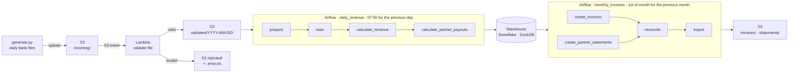

# Bank billing pipeline

[](https://github.com/shamakkkkkk/bank-billing-pipeline/actions/workflows/ci.yml)

An end-to-end billing pipeline for a savings platform: partner banks send daily
balance files, the pipeline turns them into **monthly invoices for banks** and
**payout statements for referral partners**, and refuses to export anything
that does not reconcile to the cent.

**Python · SQL · Apache Airflow 3 · Snowflake · DuckDB · AWS S3 + Lambda (LocalStack) · pytest · GitHub Actions**

---

## At a glance

| | |
|---|---|
| **Problem** | Turn ~100 customers' daily balances at 3 banks into correct invoices and partner payouts, every day and every month, despite late or broken files |
| **Revenue rule** | Each bank pays a yearly fee on deposits (0.3 / 0.5 / 0.7 %), accrued daily: `balance × rate / 365`. Referral partners get 20 % or 15 % of the revenue from customers they brought |
| **Data** | Simulated by a deterministic generator (fictional platform "SaveHub", EUR only). It can also produce five kinds of broken file on purpose |
| **Result** | October 2026 runs end to end on **Snowflake** and on DuckDB, with identical results to the last decimal: 93 bank files → 3,100 revenue rows → 3 invoices, 2 partner statements, exported as CSV |
| **Tests** | 97 unit tests, an end-to-end test against LocalStack, and a DuckDB-vs-Snowflake parity test; CI on every push |

**Where to look first**

1. [`sql/monthly/reconcile_invoices.sql`](sql/monthly/reconcile_invoices.sql): the gate before any invoice leaves the company ([how it works](docs/reconciliation.md)).
2. [`src/savehub/daily.py`](src/savehub/daily.py): idempotent loading and revenue calculation, failing loudly instead of losing money.
3. [`lambdas/validate_bank_file/validate.py`](lambdas/validate_bank_file/validate.py): file validation at the S3 boundary.
4. [`docs/runbook.md`](docs/runbook.md): what an on-call engineer does when something fails.

## How it works



| Stage | What happens | Guarantee |
|---|---|---|
| **Validate** (Lambda) | Checks columns, amounts, dates, banks and duplicate customers the moment a file lands | Broken files never reach the warehouse; the bank gets a readable reason |
| **Load** (daily) | Reads all banks' validated files for the day into `balances` | A day is loaded for every bank or not at all |
| **Revenue** (daily) | `balance × daily rate`, using the bank rate in force that day | Every balance gets revenue, or the run stops |
| **Payouts** (daily) | `revenue × partner share` for referred customers | An unknown partner stops the run |
| **Invoices, statements** (monthly) | One document per bank and per partner | Rounded to cents exactly once |
| **Reconcile** (monthly) | Recomputes every amount from the daily data | Any difference, even 0.01 €, blocks the export |

## What it produces

An invoice, exported to `s3://…/invoices/2026-10/INV-2026-10-ALPHA.csv`:

```csv
invoice_id,bank,period_start,period_end,customer_days,amount_eur,currency
INV-2026-10-ALPHA,alpha,2026-10-01,2026-10-31,899,579.18,EUR
```

A partner statement, `statements/2026-10/STM-2026-10-P01.csv`:

```csv
statement_id,partner_id,partner_name,period_start,period_end,referred_customers,referred_revenue_eur,amount_eur,currency
STM-2026-10-P01,P01,MoneyTips,2026-10-01,2026-10-31,27,858.91,171.78,EUR
```

What a bank receives when its file is rejected, `rejected/bank_gamma_2026-10-28.csv.error.txt`:

```text
File:        incoming/bank_gamma_2026-10-28.csv
Rejected at: 2026-11-18T19:08:06+00:00
Problems (1):
  - line 14: balance_eur uses a decimal comma (48211,86), expected a dot
Fix the file and upload it again to incoming/ with the same name.
```

And what the reconciliation reports when an invoice is off by one cent
(nothing is exported):

```text
ReconciliationFailed: 2026-10: 1 problem(s), nothing exported:
  invoice_amount_mismatch: beta expected 1399.74 actual 1399.75
```

## Run it locally

Requirements: Docker with 5 GB memory, [uv](https://docs.astral.sh/uv/), and a
free [LocalStack](https://app.localstack.cloud) "Hobby" auth token (no AWS
account needed).

```bash
# 1. Start Airflow, Postgres and LocalStack. LocalStack creates the S3 bucket
#    and deploys the Lambda with its S3 trigger on startup.
cp .env.example .env              # paste your LOCALSTACK_AUTH_TOKEN
docker compose up -d              # Airflow UI: http://localhost:8080
uv sync

# 2. Simulate October: 3 banks x 31 days, 2 files deliberately broken.
uv run --env-file .env generate.py --month 2026-10 --bad-files 2

# 3. Unpause daily_revenue in the UI, then process October.
#    (--to-date is 11-01: Airflow 3 bounds backfills by run time, and the run
#    for 31 October happens on 1 November.)
docker compose exec airflow airflow backfill create --dag-id daily_revenue \
    --from-date 2026-10-01 --to-date 2026-11-01
```

Two October days fail on purpose: their bank file was rejected. Fixing them is
a realistic incident, described in [the runbook](docs/runbook.md) (section 1).
Unpausing also schedules the regular run for yesterday, which waits for
yesterday's files (`generate.py --date YYYY-MM-DD`).

Once all October days are green, unpause `monthly_invoices` and run October:

```bash
docker compose exec airflow airflow backfill create --dag-id monthly_invoices \
    --from-date 2026-10-01 --to-date 2026-11-01
```

Tests:

```bash
uv run pytest                                  # 97 tests, no Docker needed
uv run --env-file .env pytest -m integration   # upload to S3, Lambda sorts it
```

**On Snowflake** (optional, a free trial account is enough):

```bash
scripts/snowflake_setup.sh                     # key pair + setup SQL with the public key
uv run --env-file .env python scripts/snowflake_admin_setup.py   # runs it as admin (password prompt)
# set SNOWFLAKE_ACCOUNT and WAREHOUSE=snowflake in .env, then
docker compose up -d airflow                   # the DAGs now write to Snowflake
uv run --env-file .env pytest -m snowflake     # parity test: DuckDB vs Snowflake
```

## Design decisions

### Money is never a float
`Decimal` in Python, `NUMERIC` in SQL, from the generator to the CSV.
**Trap found on the way:** DuckDB computes `DECIMAL / 365` as a `DOUBLE`. So SQL
never divides money: the daily rate (`annual rate / 365`, 12 decimals) is
computed once in Python, and SQL only multiplies, which stays exact.
→ [`daily.py`](src/savehub/daily.py) `daily_fee_rate`

### Round once, at the end
Daily revenue and payouts keep full precision. The only rounding in the system
is `ROUND(SUM(exact), 2)` on the monthly documents. Rounding 3,100 daily
amounts one by one would drift by cents. The exact sums are stored next to the
rounded amounts, for audit.
→ [`create_invoices.sql`](sql/monthly/create_invoices.sql)

### Every run can be repeated safely
Each step deletes what it is about to write (that day, that bank, that month)
and inserts it again, inside one transaction. Re-running a day, backfilling a
month in any order, or re-exporting gives identical results. Proven on the
running stack: reprocessing all of October produced the same 3,100 rows and the
same total to 14 decimals. Document ids are deterministic (`INV-2026-10-ALPHA`)
for the same reason.
→ [`test_daily.py`](tests/test_daily.py) `test_running_a_day_twice_changes_nothing`, `test_backfill_out_of_order_gives_same_result`

### Reconcile against the source of truth, not against itself
Before export, every invoice is recomputed from `daily_revenue` and compared to
the cent, and every partner payout is checked against the revenue from that
partner's customers. The checks deliberately ignore numbers that the document
query itself wrote, so a bug there cannot hide itself. Missing documents on
either side are caught with a `FULL OUTER JOIN`.
→ [`sql/monthly/reconcile_*.sql`](sql/monthly/), specified by 12 tests in [`test_reconcile.py`](tests/test_reconcile.py)

### Fail loudly instead of losing money silently
An inner join drops rows without a word. The pipeline counts instead: a balance
without a bank rate, a customer with an unknown partner, a day with a missing
bank or a month with a missing day each stop the run with a message that says
what to do. Retries are on where waiting helps (a late file) and off where it
cannot (a reconciliation mismatch).

### Validate at the boundary
The Lambda rejects a broken file within seconds, before anything reaches the
warehouse, and writes the reason next to it. Every defect the generator can
produce has a test proving it is caught. Amounts are checked with a strict
pattern, because `Decimal("NaN")` and `Decimal("1e5")` parse without complaint.
S3 delivers events at least once, so a duplicate event is handled as a no-op.

### Same code locally and on AWS
No endpoint or key appears in the code: boto3 and the AWS CLI read them from the
environment. `.env` points at LocalStack; [`.env.aws.example`](.env.aws.example)
shows the real-AWS setup, and the deploy script
[`infra/deploy_lambda.sh`](infra/deploy_lambda.sh) is the same for both. The
Lambda's IAM policy allows only its three S3 prefixes, and its trigger listens
to `incoming/` only, otherwise it would trigger itself in a loop. Tested against
LocalStack; the real-AWS path is configuration only and has not been run against
an AWS account.

### One codebase, two warehouses: Snowflake and DuckDB
[`warehouse.py`](src/savehub/warehouse.py) exposes `execute`, `query` and
`transaction`; nothing else talks to a database directly. `WAREHOUSE=snowflake`
runs the pipeline on Snowflake, `WAREHOUSE=duckdb` on a local file (fast, free,
used by the 97 unit tests and CI). The same `.sql` files run on both.

A parity test runs October on both engines and compares all five tables value by
value ([`test_snowflake.py`](tests/integration/test_snowflake.py)). It found two
real differences, both fixed:

- **Snowflake silently rounds products.** The scale of `a × b` is capped at
  `max(scale_a, scale_b, 12)`: `balance(…,2) × rate(…,12)` came back with 12
  decimals instead of the exact 14. Invoices still matched in cents, but that is
  a hidden second rounding. An explicit `CAST` on one factor lifts the cap.
  → [`calculate_revenue.sql`](sql/daily/calculate_revenue.sql)
- **DDL commits an open transaction in Snowflake.** Creating the month's temp
  table inside the delete-and-insert transaction would have broken its
  atomicity, so it is created before the transaction starts.
  → [`monthly.py`](src/savehub/monthly.py) `set_billing_period`

Snowflake setup is code too ([`infra/snowflake_setup.sql`](infra/snowflake_setup.sql)):
an XSMALL warehouse that suspends after 60 s, a resource monitor that stops it at
10 credits, and a least-privilege role for a **service user that logs in with a
key pair**, no password.

### Airflow dates are business dates
A `CronDataIntervalTimetable` gives the run at 07:00 on 2 October the logical
date 1 October: the day whose files arrived overnight. DAG files only define
schedule, retries and order; the logic lives in plain Python functions that are
tested without Airflow.

## Testing

| Level | What it proves | How it runs |
|---|---|---|
| Business rules | Validation, revenue, payouts and invoices match an independent `Decimal` calculation **exactly** | `uv run pytest`: DuckDB in memory, [moto](https://github.com/getmoto/moto) for S3 |
| Idempotency and backfill | Re-runs and out-of-order backfills give identical rows | same |
| Reconciliation | Each of 12 tests breaks the data in one realistic way and expects the check to catch it | same |
| End to end | A file uploaded to S3 is sorted by the deployed Lambda | `pytest -m integration` against LocalStack |
| Warehouse parity | October on Snowflake equals October on DuckDB, every value in every table | `pytest -m snowflake` (a real account, a few cents of credits) |
| DAGs | Both DAGs import in the real Airflow image | [CI](.github/workflows/ci.yml), [`check_dags.py`](scripts/check_dags.py) |

CI runs ruff, all unit tests and the DAG import check on every push.

## Operations

[`docs/runbook.md`](docs/runbook.md) covers rejected and missing files, missing
rates or partners, backfills, reconciliation failures and health checks.
Failure messages say what went wrong and what to do next, for example
`2026-10-05: no validated file for bank(s) beta. Check s3://…/rejected/ for an
.error.txt, or wait for the bank to deliver.`

## Limitations

Deliberate simplifications, each with what a production version would do:

| Simplification | In production |
|---|---|
| 365-day year, leap years included | Day-count convention from the bank contract |
| One currency, one legal entity, one bank per customer | Currency and entity on every row; FX rates with history |
| Partner shares have no history (bank rates do, via `valid_from`) | `valid_from` on partner contracts too |
| Data changed after invoicing overwrites the document | Credit notes and adjustment lines; sent documents are immutable |
| Deterministic invoice ids, not a gapless sequence | Sequential invoice numbers, as German invoicing law requires |
| A Lambda event can be lost after its retries | Dead-letter queue with an alert |
| Files read into memory, rows inserted one batch at a time | `COPY INTO` from an S3 stage for Snowflake |

**Next steps:** `COPY INTO` loads from an S3 stage on Snowflake, alerting on
failed tasks, partner share history, a dead-letter queue for the Lambda.

## Repository layout

```
dags/              daily_revenue.py, monthly_invoices.py      schedule and order only
src/savehub/       generator, warehouse interface, daily and monthly steps
sql/               schema.sql, daily/*.sql, monthly/*.sql     all warehouse SQL
lambdas/           validate_bank_file/validate.py             deployed as one file
infra/             deploy_lambda.sh, IAM policies             same for LocalStack and AWS
                   snowflake_setup.sql                        warehouse, cost cap, role, service user
localstack/init/   creates the bucket and deploys the Lambda on startup
seeds/             bank_rates.csv, partners.csv               reference data with history
tests/             unit, reconciliation and integration tests
docs/              runbook.md, reconciliation.md
.cursor/           project rules and a /scaffold-dag command for AI-assisted work
```

<!-- TODO: screenshots (Airflow grid for October, Snowflake query) -->
